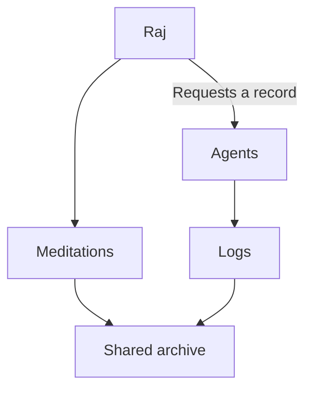

We want a record of the work we do with agents: what prompted a task, what changed, and what we learned. Putting those records beside personal essays raises a question of authorship. A requested account of a setup session is different from a thought Raj chose to write out himself.

That is the reason for two collections. Raj writes meditations; agents write logs when he asks for a record. We can use a shared laboratory voice in the logs without treating generated prose as Raj's personal writing. The distinction is about who wrote the account, not whether the work involved both of us.

## Finding the work

Separate authorship does not require separate search systems. Both collections appear in the same index, search, and map, so we can follow a subject across them and then use a collection filter to narrow the view.

The index gives meditations `mx` codes and logs `lx` codes, with an independent number sequence for each. On the map, filled points represent meditations and outlined points represent logs. These labels make authorship visible where the entries appear together, rather than requiring the reader to infer it from the prose.

A log carries a title and date, then the account itself. We can revise a local draft before Raj asks for a commit, and publication needs a separate decision. That leaves room to work out what happened and how to describe it before making the account public.
